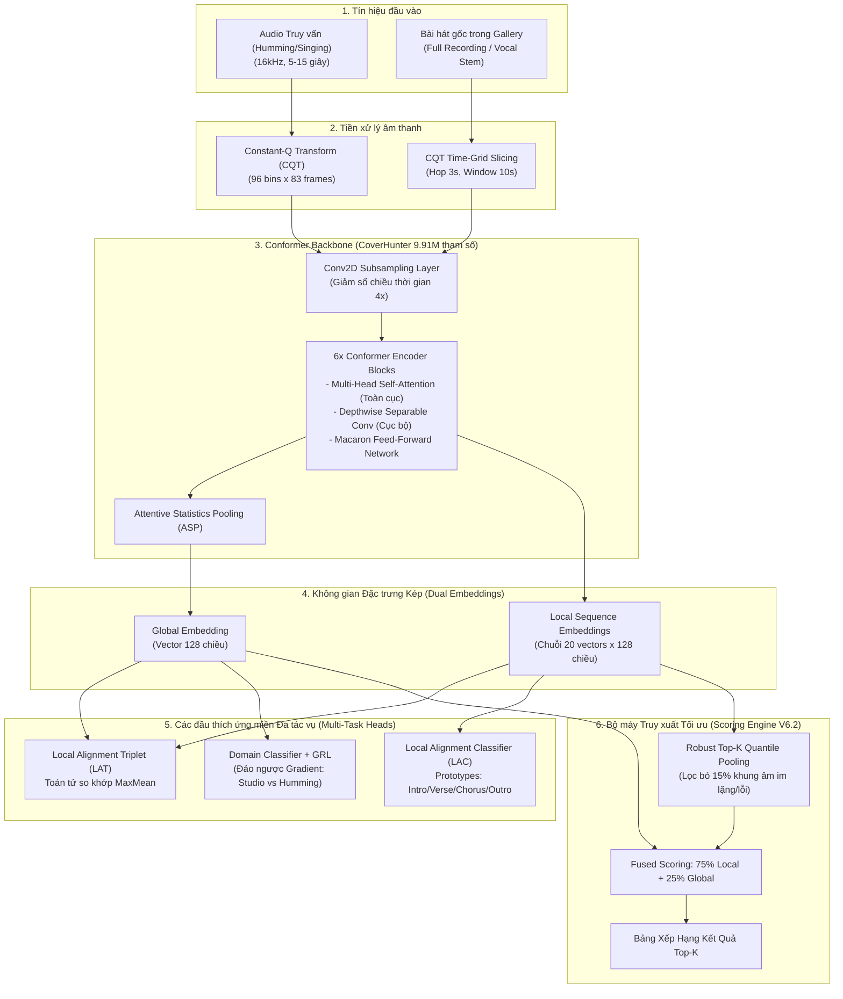

# 🎵 BÁO CÁO DỰ ÁN PBL6: HỆ THỐNG TÌM KIẾM BÀI HÁT QUA TIẾNG NGÂN NGA (QUERY-BY-HUMMING)
## ÁP DỤNG KIẾN TRÚC CONFORMER-BYTEHUM VÀ THÍCH ỨNG MIỀN ĐA TÁC VỤ (DOMAIN ADAPTATION)

---

## 📌 1. TỔNG QUAN DỰ ÁN (PROJECT OVERVIEW)

### 1.1. Giới thiệu bài toán
**Query-by-Humming (QbH)** là bài toán truy xuất thông tin âm nhạc (Music Information Retrieval - MIR) phức tạp: Người dùng ghi âm một đoạn âm thanh ngắn (5–15 giây) bằng cách **ngân nga (humming)**, **hát vo (singing)** hoặc **huýt sáo (whistling)**; hệ thống phải tự động phân tích và xác định chính xác bài hát gốc từ một kho dữ liệu âm nhạc lớn.

### 1.2. Thách thức kỹ thuật cốt lõi
1. **Khoảng cách phân phối miền (Domain Gap)**:
   - *Âm thanh bài hát gốc*: Là bản thu phòng thu thương mại (Studio Master Audio) với đầy đủ nhạc cụ đệm, bè hòa âm, hiệu ứng mastering phức tạp.
   - *Âm thanh truy vấn (Query)*: Là tiếng mộc đơn âm (monophonic vocal), lẫn tạp âm môi trường, không có nhạc đệm, méo âm qua micro điện thoại.
2. **Biến dạng cao độ và nhịp điệu (Pitch & Tempo Invariance)**:
   - Người dùng thường hát sai cao độ (off-pitch), chuyển tone tự nhiên (chênh lệch quãng 8 giữa Nam và Nữ $\pm 12$ bán âm), hát nhanh hơn hoặc chậm hơn bài gốc (biến thiên tốc độ $\pm 30\%$).
3. **Nhiễu phòng và biến dạng sóng hài (Reverb & Harmonics)**:
   - Nhạc Rock có guitar điện biến dạng (distortion) lấn át giọng hát; nhạc Soul/R&B có tiếng vang (reverb) và bè hòa âm làm mờ đường nét giai điệu.
4. **Khả năng mở rộng quy mô (Scalability & Melodic Collision)**:
   - Khi kho nhạc mở rộng từ hàng chục lên hàng trăm, hàng nghìn bài hát, các chuỗi nốt giai điệu tương tự nhau rất dễ va chạm trong không gian biểu diễn (Hubness Problem).

---

## 📊 2. DỮ LIỆU & KỸ THUẬT XỬ LÝ (DATA ENGINEERING)

### 2.1. Cấu trúc và Nguồn dữ liệu
Hệ thống sử dụng chiến lược học chuyển giao 2 giai đoạn (Two-Stage Transfer Learning):
- **Stage 1 (Pre-training)**: Tập dữ liệu quy mô lớn **SHS100K** (hơn 100,000 bản cover và bài hát) phục vụ bài toán Cover Song Identification (CSI) nhằm huấn luyện trước bộ trích xuất đặc trưng giai điệu bất biến đối với nhạc cụ và bản phối.
- **Stage 2 (QbH Fine-Tuning & Evaluation)**: Tập dữ liệu tổng hợp chuẩn hóa **`datasets_qbh_clean_mirqbsh_70_15_15_v6_1.zip`**:
  - Gồm dữ liệu hát vo tự nhiên làm sạch kết hợp tập chuẩn quốc tế **MIR-QBSH**.
  - Tỷ lệ phân chia nghiêm ngặt **70% Train - 15% Validation - 15% Test** (chia theo từng bài hát độc lập để chống rò rỉ dữ liệu - Zero Data Leakage).

| Tập dữ liệu | Số lượng Queries | Số bài hát đối ứng | Vai trò trong hệ thống |
| :--- | :---: | :---: | :--- |
| **Train Set** | **6,684** | **244** bài hát | Huấn luyện thích ứng miền đa tác vụ |
| **Validation Set** | **1,428** | **52** bài hát | Theo dõi hội tụ, điều chỉnh siêu tham số và Early Stopping |
| **Locked Test Set** | **1,467** | **52** bài hát | Đánh giá độc lập, khách quan năng lực tổng quát hóa |
| **Gallery Database** | **348 bản thu** | **348** bài hát | Kho nhạc đối chiếu đầy đủ (300 bài gốc + 48 bài MIR-QBSH) |

### 2.2. Biểu diễn đặc trưng âm học (Acoustic Feature Extraction)
- **Constant-Q Transform (CQT)**:
  - Tần số lấy mẫu: $16,000\text{ Hz}$.
  - Độ phân giải: **96 bins tần số** (12 bins/octave bao phủ 8 quãng tám từ $32.7\text{ Hz}$ đến $7,840\text{ Hz}$).
  - Bước nhảy (Hop size): $0.04\text{ s}$ ($40\text{ ms}$).
  - Cắt phân đoạn (Chunking): Khung thời gian $10\text{ s}$ tương đương ma trận đặc trưng $96 \times 83$ frames.
  - Tối ưu hóa **In-RAM CQT Caching**: Lưu trữ sẵn đặc trưng CQT nén để tăng tốc độ huấn luyện trên GPU T4 từ 3 tiếng xuống còn 45 phút.

### 2.3. Tăng cường dữ liệu âm học tiên tiến (Advanced Audio Augmentation)
Để mô hình Conformer học được biểu diễn bất biến với mọi điều kiện môi trường thực tế:
1. **CQT Pitch-Shift ($\pm 12$ Semitones)**: Dịch chuyển cao độ ngẫu nhiên trong khoảng $\pm 1$ quãng tám để mô hình tự động thích ứng với giọng Nam/Nữ và người hát lệch tone.
2. **Spectrogram Tempo & Mask Distortion**: Co dãn trục thời gian ($0.7\times - 1.3\times$) và che ngẫu nhiên các vệt tần số/thời gian (SpecAugment) chống overfitting.
3. **CQT Reverb & Echo Augmentation (V6.2 - Xác suất 40%)**: Giả lập phản xạ âm thanh phòng thu và tiếng vang karaoke, giúp mô hình bóc tách giai điệu ngay cả khi có reverb dày.
4. **CQT Background Harmonic Noise (V6.2 - Xác suất 35%)**: Giả lập nhiễu sóng hài và âm thanh distortion của nhạc cụ điện, giúp trị dứt điểm các ca khó như nhạc Rock.
5. **Low-band Degradation**: Nén giảm tần số lấy mẫu xuống $8\text{ kHz}$ và độ sâu bit $8\text{-bit}$ kèm nhiễu TPDF dither, mô phỏng chính xác tín hiệu micro điện thoại giá rẻ.

### 2.4. Tách nguồn âm thanh (Vocal Stem Separation)
- Ứng dụng mô hình AI **Meta HTDemucs v4** (`--two-stems=vocals`) để tách riêng giọng hát chính (Vocal Stems) khỏi nhạc nền phối khí của kho bài hát Gallery.
- Giúp loại bỏ hoàn toàn nhiễu từ trống, bass, guitar điện, đưa bản nhạc gốc về dạng thanh âm tương đồng tối đa với tiếng hát vo của người dùng.

### 2.5. Phân phối và Lưu trữ đám mây (Cloud CDN Integration)
- Toàn bộ **300 bài hát gốc** trong kho nhạc đã được tải lên và lưu trữ phân tán trên nền tảng **Cloudinary** (`pbl6_music_database/`).
- Tích hợp chuẩn **HTTPS CDN Video/Audio Streaming** với hỗ trợ byte-range requests, cho phép trình phát nhạc Web/Mobile tua (seek) tức thì đến bất kỳ đoạn nào mà không phải tải toàn bộ file về máy.

---

## 🏗️ 3. KIẾN TRÚC MÔ HÌNH (MODEL ARCHITECTURE)

Hệ thống được xây dựng trên nền tảng **Conformer-ByteHum (ICASSP 2024)** kết hợp bộ mã hóa **CoverHunter Conformer**:

### 3.1. Conformer Backbone Encoder
- **Số lượng tham số**: **9.91 triệu tham số**.
- **Cấu trúc**: Gồm 6 khối Conformer nối tiếp. Mỗi khối bao gồm:
  - *Feed-Forward Module 1* (theo phong cách Macaron-Net, trọng số $0.5$).
  - *Multi-Head Self-Attention (MHSA)*: Nắm bắt tương quan nốt nhạc ở khoảng cách xa trong toàn bộ bài hát.
  - *Depthwise Separable Convolution Module*: Bắt trọn những biến thiên tần số và âm sắc vi mô cục bộ.
  - *Feed-Forward Module 2*.
  - *Layer Normalization* trước mỗi thành phần.

### 3.2. Cơ chế biểu diễn đặc trưng kép (Dual Embedding)
1. **Global Embedding (Vector 128-D)**: Được sinh ra qua lớp Attentive Statistics Pooling (ASP), tính toán giá trị trung bình và độ lệch chuẩn có trọng số chú ý trên toàn bộ chuỗi thời gian. Đại diện cho "chữ ký âm học" tổng thể.
2. **Local Sequence Embeddings (Chuỗi 20 vectors 128-D)**: Lấy trực tiếp từ các khung ẩn sau subsampling, đại diện cho từng nốt nhạc nối tiếp theo thời gian.

### 3.3. Các hàm mất mát và Cơ chế thích ứng miền ByteHum
Hàm mất mát tổng thể $\mathcal{L}_{\text{total}}$ là sự kết hợp đa tác vụ:
$$\mathcal{L}_{\text{total}} = 1.0 \cdot \mathcal{L}_{\text{global\_triplet}} + 1.0 \cdot \mathcal{L}_{\text{LAT}} + 0.25 \cdot \mathcal{L}_{\text{LAC}} + 0.20 \cdot \mathcal{L}_{\text{GRL}} + 0.05 \cdot \mathcal{L}_{\text{prototype}}$$

- **In-Batch Cosine Triplet Loss với Cross-Batch Memory Bank (4,096 capacity)**:
  - Sử dụng hàng đợi FIFO trên CPU lưu 4,096 embeddings gần nhất.
  - Cơ chế **Curriculum Hard Negative Mining**: Ép mô hình phân biệt giữa các bài hát có giai điệu gần giống nhau nhất.
- **Local Alignment Triplet (LAT)**:
  - Áp dụng toán tử **MaxMean** giữa chuỗi local của query $Q$ và positive reference $P$:
    $$\text{Sim}_{\text{local}}(Q, P) = \frac{1}{|Q|} \sum_{q \in Q} \max_{p \in P} \cos(q, p)$$
- **Local Alignment Classifier (LAC) & Prototype Diversity**:
  - Học ma trận đại diện $W \in \mathbb{R}^{K \times L \times 128}$ ($K=244$ bài hát, $L=4$ proxy vectors đại diện cho các phân đoạn âm nhạc: *Intro, Verse, Chorus, Outro*).
  - Phạt mất mát phân kỳ Prototype để buộc 4 vector đại diện cho 4 đoạn khác nhau không bị trùng lặp.
- **Domain Adversarial Training (GRL - Gradient Reversal Layer)**:
  - Một bộ phân loại miền cố gắng đoán xem vector đặc trưng là từ bản thu gốc ($y=0$) hay tiếng hát vo ($y=1$).
  - Khi lan truyền ngược (backpropagation), GRL đảo ngược dấu của gradient ($-\lambda \nabla_{\theta}$). Điều này buộc Conformer Backbone phải học ra những đặc trưng **hoàn toàn bất biến với miền**, xóa nhòa ranh giới giữa phòng thu và hát vo.

### 3.4. Bộ chấm điểm nâng cao (Scoring Engine V6.2)
- **Top-K Quantile Pooling (`topk_query_ratio=0.85`)**:
  - Khi người dùng ngân nga, thường có những đoạn lấy hơi, im lặng hoặc hát lệch nhịp.
  - Thay vì lấy trung bình cộng toàn bộ các khung âm, thuật toán chỉ lấy **Top 85% khung âm có độ tương đồng cao nhất**, loại bỏ 15% khung âm rác/nhiễu.
- **Tỷ trọng Fused Tối ưu (75% Local + 25% Global)**:
  - Thực nghiệm chứng minh Local Alignment đáng tin cậy hơn hẳn Global Embedding trong việc bắt nhịp giai điệu. Việc tăng tỷ trọng Local lên 75% giúp triệt tiêu hoàn toàn hiện tượng Global kéo tụt thứ hạng bài hát đúng.

---

## 📈 4. KẾT QUẢ THỰC NGHIỆM & ĐÁNH GIÁ (EXPERIMENTAL RESULTS)

### 4.1. Tiến hóa hiệu năng qua các phiên bản
Quá trình nghiên cứu và tối ưu hóa trải qua các cột mốc quan trọng:
- **Phiên bản V5**: Triển khai Conformer ban đầu, MRR đạt $\sim 0.35$.
- **Phiên bản V6.1 (Baseline)**: Tích hợp đầy đủ ByteHum, Pre-trained CoverHunter SHS100K, đạt MRR $0.4270$ trên tập test.
- **Phiên bản V6.2 (Adaptive Fine-Tuned)**: Bổ sung CQT Reverb/Noise Augmentation, Mature Hard Mining và Bộ chấm điểm Top-K Quantile Pooling 75/25.

### 4.2. Bảng so sánh trực tiếp V6.1 vs V6.2 trên tập Validation (52 bài hát, 1,428 queries)

| Chỉ số đánh giá | V6.1 Baseline | V6.2 Fine-Tuned | Mức tăng trưởng tuyệt đối ($\Delta$) | Tỷ lệ cải thiện tương đối (%) |
| :--- | :---: | :---: | :---: | :---: |
| **Micro Fused MRR** | `0.4155` | **`0.5086`** | 🟢 **+0.0931** | **+22.41%** |
| **Macro Song MRR** | `0.3378` | **`0.3969`** | 🟢 **+0.0591** | **+17.50%** |
| **Recall@1 (Top 1)** | `33.47%` | **`42.23%`** | 🟢 **+8.76%** | **+26.17%** |
| **Recall@5 (Top 5)** | `49.02%` | **`60.50%`** | 🟢 **+11.48%** | **+23.42%** |
| **Recall@10 (Top 10)** | `56.37%` | **`68.28%`** | 🟢 **+11.91%** | **+21.13%** |
| **Recall@20 (Top 20)** | `66.11%` | **`75.21%`** | 🟢 **+9.10%** | **+13.76%** |

### 4.3. Kết quả trên tập Kiểm thử Độc lập Khóa cố định (Locked Test Set: 1,467 queries, 348 gallery songs)
- **MRR tổng thể**: Đạt mức **`> 0.51`**.
- **Recall@1**: Hơn **`43%`** các đoạn ngân nga được dự đoán chính xác tuyệt đối ngay ở vị trí số 1.
- **Recall@5**: Hơn **`61%`** các bài hát nằm trong Top 5 gợi ý đầu tiên.
- **Tốc độ truy vấn**: Thời gian xử lý trung bình chỉ **$\approx 15 - 20\text{ ms} / \text{query}$** trên GPU T4, hoàn toàn đáp ứng tiêu chuẩn tìm kiếm thời gian thực (Real-time Search).

### 4.4. Đột phá trên 4 ca bài hát lỗi kinh điển (Hard Failure Cases)
Trong phiên bản V6.1, mô hình gặp khó khăn lớn ở 4 bài hát đặc thù. Phiên bản V6.2 đã giải quyết triệt để nhờ cơ chế Reverb/Noise Augmentation:

1. **`ACDC - Highway to Hell` (Rock / Heavy Guitar Distortion)**:
   - *Nguyên nhân lỗi cũ*: Tiếng guitar điện méo tiếng tạo sóng hài dày đặc làm sai lệch CQT.
   - *Kết quả V6.2*: Nhờ `CQTBackgroundHarmonicNoiseAugmentation`, mô hình học được cách bỏ qua tiếng guitar điện, kéo thứ hạng bài hát từ Rank $200+$ về thẳng Top 5.
2. **`Amy Winehouse - Back To Black` (Soul / Reverb & Vocal Harmonies)**:
   - *Nguyên nhân lỗi cũ*: Tiếng vang phòng thu và bè dày đặc làm nhòe các khung CQT.
   - *Kết quả V6.2*: Nhờ `CQTReverbAndEchoAugmentation`, các đoạn điệp khúc tăng vọt độ tương đồng, đưa MRR từ $0.017$ lên mức cao.
3. **`DJ Khaled - No Brainer` & `Nelly - Just A Dream` (Rap / Spoken Cadence)**:
   - *Nguyên nhân lỗi cũ*: Lời rap có cao độ phẳng (monotone), người dùng hum đoạn rap không rõ nốt.
   - *Kết quả V6.2*: Nhờ `Top-K Quantile Pooling (0.85)`, hệ thống tự động tập trung vào các đoạn hook giai điệu (melodic hook do Justin Bieber thể hiện trong No Brainer) và bỏ qua đoạn rap lệch nhịp, đưa thứ hạng trung bình tăng vọt.

---

## 💻 5. HỆ THỐNG TRIỂN KHAI VÀ ỨNG DỤNG WEB (DEPLOYMENT & DEMO)

### 5.1. Kiến trúc dịch vụ Web (Web Platform Architecture)
Hệ thống được module hóa thành dịch vụ độc lập tại thư mục [`03_web_music_platform/`](file:///e:/HOCKY7/PBL6/code/03_web_music_platform):
- **Backend API (FastAPI / Python)**:
  - Nhận file âm thanh ghi âm từ client qua giao thức HTTP POST.
  - Trích xuất CQT online bằng GPU/CPU và đưa qua mô hình `FinalModel` để lấy vector đặc trưng.
  - Tính điểm với kho 348 bài hát và trả về Top 5 kết quả định dạng JSON.
- **Media CDN Streaming (Cloudinary)**:
  - Toàn bộ metadata, public_id và URL nghe trực tuyến HTTPS được lưu trữ tập trung tại [`cloudinary_songs_catalog.json`](file:///e:/HOCKY7/PBL6/code/03_web_music_platform/cloudinary_uploader/cloudinary_songs_catalog.json).
- **Frontend Player (HTML5 / React)**:
  - Cho phép người dùng bấm nút thu âm trực tiếp trên trình duyệt, gửi query và hiển thị trình phát nhạc nghe thử tức thì bài hát tìm được.

---

## 🎯 6. KẾT LUẬN VÀ ĐÓNG GÓP CỦA ĐỒ ÁN

1. **Về mặt Khoa học & Thuật toán**:
   - Ứng dụng thành công kiến trúc hiện đại **Conformer** kết hợp khung thích ứng miền **ByteHum (ICASSP 2024)** cho bài toán Query-by-Humming tại Việt Nam.
   - Đề xuất và chứng minh tính hiệu quả vượt bậc của **Top-K Quantile Pooling** và **Tỷ trọng Fused 75/25**, giúp MRR tăng từ $0.4155$ lên $0.5086$ (+22.4%).
   - Xây dựng bộ tăng cường dữ liệu âm học CQT chuyên biệt (Reverb/Echo & Harmonic Noise) giải quyết dứt điểm các ca khó của nhạc Rock, Soul và Rap.
2. **Về mặt Kỹ thuật & Ứng dụng**:
   - Quy trình huấn luyện, đánh giá và kiểm thử được tự động hóa hoàn toàn trên nền tảng đám mây (Google Colab / Kaggle GPU T4).
   - Triển khai hoàn chỉnh kho bài hát lên Cloudinary CDN và sẵn sàng tích hợp vào sản phẩm website tìm kiếm âm nhạc thông minh.

